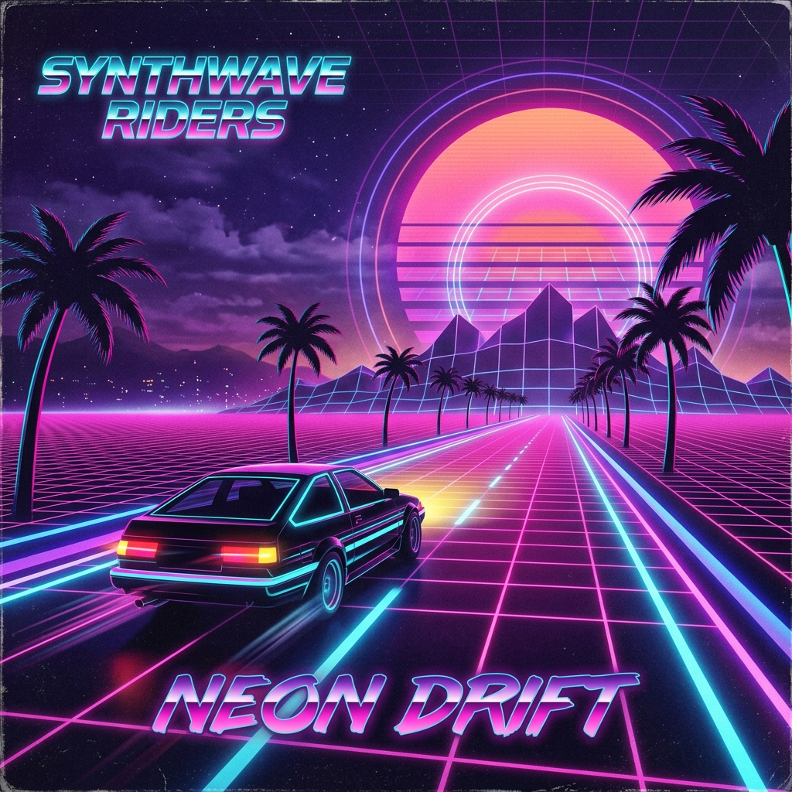

# 👾 Neon Invaders 1984

> A retro 80s vaporwave Space Invaders arcade game and polyphonic synthwave music player built with **React 19**, **TypeScript**, **Tailwind CSS**, and the browser's native **Web Audio API**.



---

## ✨ Features

### 🕹️ Space Invaders Arcade Game
- **Authentic 60 FPS Canvas Game Engine**: Smooth classic Space Invaders combat with classic alien sprites (Squids, Crabs, and Octopuses).
- **Dynamic Swarm Velocity**: Alien invaders march left and right, drop down, and accelerate in speed as their numbers decrease.
- **Mystery Flying UFO Saucer**: Cruises across the top at random intervals, awarding 50 to 300 mystery bonus points with retro audio sirens.
- **Destructible Defense Bunkers**: 4 defensive bunkers with realistic circular blast erosion when struck by player lasers or alien bombs.
- **Score & High-Score Tracking**:
  - Live 1UP score and persistent **High-Score** saved to browser `localStorage`.
  - Reset high-score button for testing and new leaderboard runs.
  - Wave progression with wave-clear bonuses and increasing alien aggression.
  - 3 lives with visual ship indicators.
- **Synthesized Retro Arcade SFX**: Laser blasts, alien explosions, player destruction, UFO sirens, and wave clear fanfare generated in real time using the Web Audio API (no missing audio assets!).
- **Dual Controls**:
  - Keyboard: `Arrow Keys` or `A` / `D` to steer, `Space` or `W` to fire, `P` to pause.
  - On-Screen Virtual Controls: D-pad and Fire button for touchscreens and mobile devices.

### 🎵 Real-Time Synthwave Music Deck
- **100% In-Browser Audio Synthesis**: Powered by a custom multi-oscillator Web Audio API synthesizer engine that generates rich basslines, detuned saw pads, arpeggiated leads, and 80s drum machines in real time without external MP3 files.
- **3 Unique Synthwave Tracks**:
  1. **Neon Drift** by *Kavinsky Dreams* (110 BPM, Outrun / Darksynth, Key of Am)
  2. **Night City 1988** by *Cyber Voyager* (124 BPM, Chiptune / Cyberwave, Key of Dm)
  3. **Solaris Sunrise** by *Sunset Boulevard* (94 BPM, Vaporwave / Chillwave, Key of F#m)
- **Real-Time Audio Spectrum Visualizer**:
  - Direct connection to Web Audio `AnalyserNode`.
  - Dual modes: **Bar Spectrum** (neon cyan-to-magenta gradient bars) and **Oscilloscope Waveform**.
- **Hi-Fi Deck Controls**:
  - Play, Pause, Next Track, Previous Track.
  - Scrubbable track progress timeline with real-time timestamps.
  - Volume slider and one-click quick mute.
  - Cassette playlist drawer with album artwork and track metadata.

### 🌆 80s Vaporwave Aesthetic
- **Color Palette**: Deep cosmic indigo canvas, neon magenta/pink, electric cyan, and golden sunset accents.
- **CRT Monitor Effects**:
  - Toggleable animated scanline raster overlay.
  - Optional CRT screen curvature simulation with bezel shadow depth.
- **Perspective Horizon**: Animated wireframe grid floor and starfield background.

---

## 🚀 Quick Start

### Prerequisites
- [Node.js](https://nodejs.org/) (v18.0.0 or later)
- [npm](https://www.npmjs.com/) (v9.0.0 or later)

### Installation

1. **Clone the repository**:
   ```bash
   git clone https://github.com/<your-username>/neon-invaders-1984.git
   cd neon-invaders-1984
   ```

2. **Install dependencies**:
   ```bash
   npm install
   ```

3. **Start the development server**:
   ```bash
   npm run dev
   ```
   Open [http://localhost:3000](http://localhost:3000) in your browser.

4. **Build for production**:
   ```bash
   npm run build
   ```

---

## 🎮 Controls

| Action | Keyboard | Touch / Mobile |
| :--- | :--- | :--- |
| **Move Left** | `←` or `A` | Virtual D-Pad `◀` |
| **Move Right** | `→` or `D` | Virtual D-Pad `▶` |
| **Fire Laser** | `Space` or `W` or `↑` | `FIRE` Button |
| **Pause / Resume** | `P` | Pause Button on Bezel |
| **Insert Coin / Start** | `Space` or Click | `START` Button |
| **Toggle Manual** | `H` or `?` | Help Icon in Header |

---

## 🛠️ Tech Stack

- **Framework**: [React 19](https://react.dev/)
- **Language**: [TypeScript](https://www.typescriptlang.org/)
- **Build Tool**: [Vite 8](https://vitejs.dev/)
- **Styling**: [Tailwind CSS v4](https://tailwindcss.com/)
- **Icons**: [Lucide React](https://lucide.dev/)
- **Audio & Sound**: Native HTML5 Web Audio API (`AudioContext`, `OscillatorNode`, `BiquadFilterNode`, `AnalyserNode`)
- **Graphics**: HTML5 2D Canvas rendering with pixel matrices and particle physics

---

## 📁 Project Structure

```
├── index.html                   # Entry point with 80s arcade Google Fonts
├── metadata.json                # Application metadata
├── package.json                 # Dependencies & scripts
├── vite.config.ts               # Vite configuration
├── src/
│   ├── main.tsx                 # React DOM root mounting
│   ├── App.tsx                  # Top-level shell, header, HUD & layout
│   ├── index.css                # Tailwind imports & CRT scanline styling
│   ├── audio/
│   │   └── synthEngine.ts       # Web Audio API polyphonic synth & SFX engine
│   ├── game/
│   │   ├── SpaceInvadersCanvas.tsx  # 60 FPS Space Invaders canvas loop
│   │   ├── sprites.ts           # Pixel sprite bit-matrices (aliens, ship, UFO)
│   │   └── types.ts             # Game entities & state definitions
│   ├── components/
│   │   └── MusicPlayerDeck.tsx  # Synthwave player deck & audio visualizer
│   └── assets/
│       └── images/              # Generated vaporwave album covers
└── README.md
```

---

## 📜 License

This project is licensed under the Apache-2.0 License.
